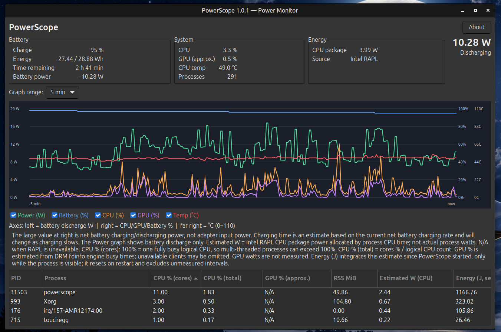

# PowerScope

**A lightweight, native Linux battery and power monitor.**

PowerScope brings battery power, CPU and GPU activity, CPU temperature, and process statistics together in one GTKmm dashboard. It is written in C++17 and uses Cairo for live charts.



## Features

- **Battery monitoring:** charge level, remaining energy, battery-side charging/discharging power, and estimated time remaining.
- **Live charts:** battery power (W), battery charge (%), CPU usage (%), approximate GPU activity (%), and CPU temperature (°C).
- **Selectable time range:** zoom between short and longer monitoring windows; toggle individual series.
- **System overview:** CPU usage, approximate GPU usage, CPU package temperature, and process count.
- **Intel RAPL support:** show CPU package power when the kernel exposes a readable RAPL energy counter.
- **Process table:** PID, process name, CPU usage (per-core and whole-system scales), approximate GPU activity where available, resident memory, estimated CPU-related power, and accumulated estimated energy for the current session.
- **Desktop integration:** application icon, launcher, settings persistence, and Debian package generation.

## Requirements

- Linux with `/proc` and the relevant `/sys` interfaces
- C++17 compiler, CMake, pkg-config, GTKmm 3 development files
- Optional: Intel RAPL (`/sys/class/powercap/`) and supported DRM GPU accounting

Developed and tested on **Linux Mint** with an **Intel U300** laptop. Hardware support and the availability of individual measurements vary by device and kernel.

## Build from source

On Ubuntu / Linux Mint:

```bash
sudo apt install build-essential cmake pkg-config libgtkmm-3.0-dev
cmake -S . -B build -DCMAKE_BUILD_TYPE=Release
cmake --build build -j"$(nproc)"
./build/powerscope
```

## Build a `.deb` package

```bash
(cd build && cpack -G DEB)
```

Install the resulting package using its actual generated filename, for example:

```bash
sudo apt install ./build/powerscope_1.0.1_amd64.deb
```

Alternatively, download the `.deb` attached to a GitHub Release once one is published.

## Understanding the measurements

**Battery power is not total system power.** It is measured on the battery side. During discharge it indicates battery power draw; during charging it indicates the net power flowing into the battery, not the power delivered by the wall charger.

**Intel RAPL** reports a CPU package energy domain when supported. It is not a whole-laptop power meter. Depending on hardware, its accounting may include integrated graphics and other package components.

**Estimated process power and energy are not direct electrical measurements.** PowerScope apportions package power using process CPU time; accumulated energy is an estimate over the monitored session, not a hardware per-process energy counter. Background processes and work outside the observation interval may not be fully represented.

**GPU activity is approximate.** It relies on available DRM process accounting and may be unavailable (`N/A`) for some drivers or processes.

**Time remaining is an estimate.** Battery load and charging rate change over time, especially as charging approaches completion.

## RAPL access

On some distributions, `/sys/class/powercap/intel-rapl:0/energy_uj` is readable only by root. PowerScope does **not** need to run as root for its GUI. If RAPL displays `N/A`, inspect permissions and configure a narrowly scoped, persistent read-access rule appropriate for your distribution. Avoid running the entire application with `sudo`.

## License

MIT — see [LICENSE](LICENSE).
